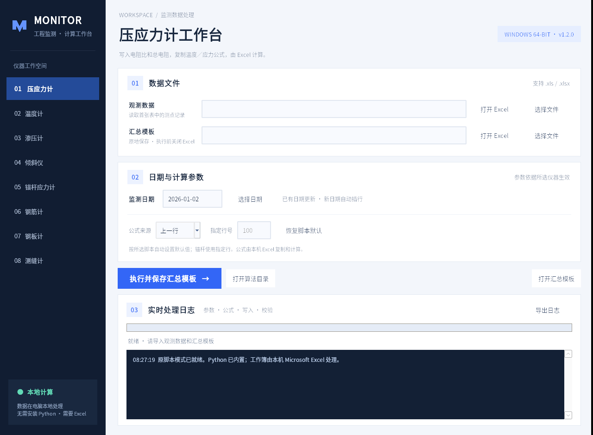

# MONITOR 新脚本界面版 v1.2.0

- [下载 Windows exe](https://raw.githubusercontent.com/luoqiu132/luoqiu/monitoringdesk-v1.2.0/MonitoringDesk.exe)
- [下载完整程序包 ZIP](https://github.com/luoqiu132/luoqiu/archive/refs/tags/monitoringdesk-v1.2.0.zip)

需要 Windows 10/11 64 位及已安装的 Microsoft Excel 桌面版。不用安装 Python，运行时无需联网。

## 使用

关闭旧版，将新版解压到新文件夹，运行 MonitoringDesk.exe，确认右上角 v1.2.0。
选择仪器、观测数据、汇总模板和日期；确认公式来源，点击“执行并保存汇总模板”。
直接修改并保存选中的汇总模板，不导出新的结果工作簿。执行前保存并关闭该模板已有的 Excel 窗口。
“打开 Excel”可查看或手动编辑文件；“实时处理日志”显示脚本运行过程。

使用本次更新的八类脚本：压应力计、温度计、渗压计、倾斜仪、锚杆应力计、钢筋计、钢板计、测缝计。旧的两种测缝计入口合为一个。

| 仪器 | 脚本默认公式来源 |
| --- | --- |
| 压应力计、温度计、渗压计 | 上一行 |
| 倾斜仪、钢筋计、钢板计、测缝计 | 第 100 行 |
| 锚杆应力计 | 第 489 行 |

可在界面选择“指定行”或“上一行”；锚杆只使用指定行。点击“恢复脚本默认”重新读取对应默认值。
模板需有相应公式。日期识别、插行、数据写入、公式复制和保存均按更新脚本执行，由本机 Excel 计算。

## 在本机修改算法

点击“打开算法目录”，首次会将内置脚本提取到 exe 同级 algorithms 文件夹，已有文件不会被覆盖。
用记事本或代码编辑器编辑对应 .py，保存为 UTF-8。下次执行会重新读取，不用安装 Python，也不用重新打包。
如果修改了默认公式行或模式，保存后点击“恢复脚本默认”。运行日志显示实际加载路径。

界面覆盖脚本的文件路径、日期和公式来源参数。保持原脚本的这些输入变量及日期窗口边界结构，可修改其余数据列和计算处理代码。新增第三方库、仪器类型或修改主界面，需要完整源码及重新打包。
将程序放在可写文件夹。升级时使用新文件夹，避免先前自定义的 algorithms 脚本覆盖新版内置脚本。移走对应外部 .py 后重启可恢复该类内置版本。

本次下载包仅发布 exe、说明和界面截图，未另行上传完整源码包或独立 .py 文件。

## 验证范围

八份更新脚本适配前后算术表达式逐项保持一致。Linux 与 Windows Python/Wine 中，六组测试覆盖全部仪器的写入列、公式复制、参数覆盖、日期插行、只读拒绝、原地 Save 且不调用 SaveAs，以及本机外部脚本修改后重新读取。
独立 exe 已在隐藏构建 Python 后通过运行库自检及八类导航、默认参数、公式控件、日历、窗口渲染检查。
构建机没有 Microsoft Excel，COM 调用测试使用协议替身；实际模板的计算值仍请在目标电脑核对。
